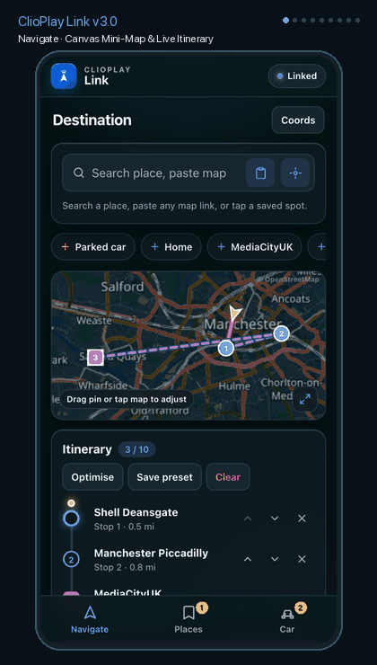

<h1 align="center">ClioPlay Link</h1>
<p align="center">Companion web app for <strong>ClioPlay</strong> on Renault Carminat TomTom (Clio 3, Megane 3, Scenic 3, Laguna 3, Kangoo, Trafic, Fluence): instant bidirectional Bluetooth navigation, live GPS multi-stop itinerary planning, zero-menu optical QR sync, full car settings &amp; driving insights.</p>
<p align="center">
  Created and maintained by <a href="https://github.com/pxwel-dev">Pawel (pxwel-dev)</a>.
</p>

<p align="center">
  
</p>

## Highlights in v3.0

- **Three clean tabs (`Navigate · Places · Car`):**
  - **Navigate:** Unified Omnibox (free OpenStreetMap search + Google/Apple/CoMaps/Waze/OSM link & coordinate parser + instant local matches), 60 fps zero-dependency Canvas Mini-Map with drag-to-nudge pin and pre-drive map-coverage check, Carminat-style vertical itinerary progress rail with live phone GPS position, offline 2-opt stop optimiser, and compact remote Cancel Route / Skip Stop controls.
  - **Places:** Symmetrical **↑ Sync to Car** & **↓ Sync from Car**, Where I Parked (with Walk Back directions), pinned **Home & Work** cards, **Saved** (with `Phone only` pending-sync dots), **Trip Presets**, and **Recent** sends.
  - **Car:** Head-Unit status hero with live Link Ping & smart update badge, **`mobility.h` / `mobility_ml.h` Driving Insights** visualiser (odometer totals, 7-day & 24h driving rhythm, learned road-class & cold-weather pace, top places & slowdown hotspots), full **18-field Car Settings (`prefs.ini`)** editor with sticky `Apply N changes to Car` bar, 1-tap Restore Full Profile, 1-file JSON Backup & Restore, and OS-specific Share from Maps setup.
- **Instant Bidirectional `CLP3` Bluetooth Link:** Confirmed ~0.3 s delivery via AVRCP `ACK`/`NACK` on ClioPlay v3.0, with automatic fallback to timed `CLP2` windows on ClioPlay v2.2.x.
- **Zero-Menu Optical QR Sync:** Tap **Sync from Car** to pop up a compact frosted-glass QR pill right on ClioPlay's map screen and transfer your car's favourites, active trip, recents, settings, map coverage and driving insights in ~2 seconds — powered by native `BarcodeDetector` on Android Chrome and a zero-dependency offline pure-JS QR decoder (`qr-decode.js`) on iOS Safari.
- **Exact ClioPlay Day/Night UI & 18 Languages:** Exact RGB565 Day & Night palettes from ClioPlay with `System / Dark / Light` themes, and full localisation across all **18 ClioPlay languages** (`en, fr, es, de, it, pt, nl, pl, tr, el, uk, ru, ar, zh-Hans, ja, ko, hi, he`) including native RTL (`dir="rtl"`) for Arabic and Hebrew.

## Host & Test

Serve this folder over HTTPS (or `http://localhost` for local development):

```sh
python3 -m http.server 8000
```

Run the full automated Node test suite:

```sh
node --test tests/*.test.mjs
```

All asset paths are relative and precached by `sw.js` for 100% offline-first operation on GitHub Pages (`https://pxwel-dev.github.io/ClioPlay-Send/`).
